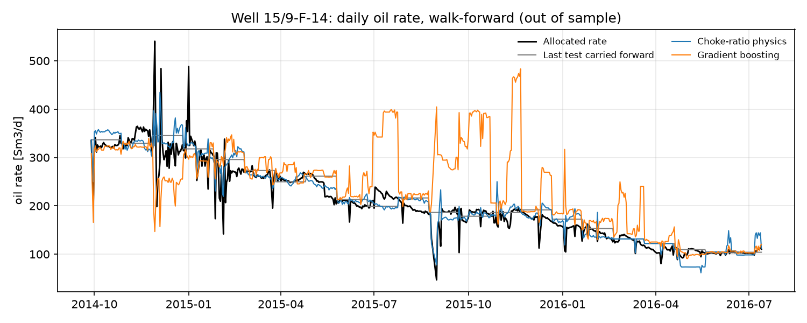
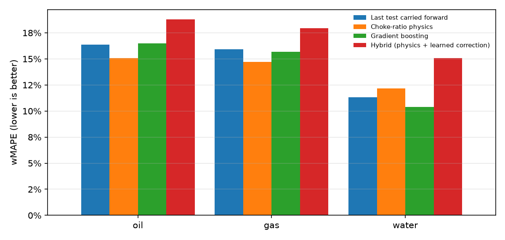

# vfm-volve

[](https://github.com/iamkane22/vfm-volve/actions/workflows/ci.yml)

**Virtual flow metering on the Equinor Volve field.** Daily oil, gas and water rates per
well, estimated from downhole and wellhead sensors with a physics model, a gradient-boosted
model and a hybrid of the two, and evaluated the way a meter is used in operation:
recalibrated after each monthly well test and run blind until the next one.



*Well 15/9-F-14, two years of out-of-sample predictions. The physics meter (blue) stays
close to the allocated rate; gradient boosting (orange) jumps when it meets sensor
patterns it has not seen before.*

## Why

Multiphase flow meters are expensive and drift, so most wells are measured directly only
during periodic well tests. Between tests, engineers estimate rates from the sensors that
are always on: choke opening, pressure drop across the choke, wellhead and downhole
pressure and temperature. This is *virtual flow metering* (VFM). This repository builds and
honestly benchmarks such a meter on public data from a real North Sea field.

## Results

Walk-forward evaluation over the last 24 months of the field (24 monthly recalibrations,
2,829 well-days, 6 producing wells). wMAPE is the sum of absolute errors divided by the
sum of actual rates; volume bias compares cumulative predicted and actual volumes.

| Meter | Oil wMAPE | Oil R² | Oil bias | Gas wMAPE | Water wMAPE | Water R² |
|---|---:|---:|---:|---:|---:|---:|
| Well mean (no sensors) | 174.2% | -5.40 | +160.3% | 164.9% | 53.9% | 0.31 |
| Last test carried forward | 16.4% | 0.85 | +0.8% | 15.9% | 11.3% | 0.89 |
| **Choke-ratio physics** | **15.1%** | 0.83 | +3.7% | **14.7%** | 12.1% | 0.86 |
| Gradient boosting | 16.5% | **0.90** | +2.7% | 15.7% | **10.4%** | **0.95** |
| Hybrid (physics + learned correction) | 18.8% | 0.81 | +1.7% | 17.9% | 15.1% | 0.90 |



What the numbers say:

* **"Last test carried forward" is the bar to beat**, and it is a high bar: on a monthly
  calibration cycle rates change slowly. A VFM result that does not report this baseline
  says little.
* The **choke-ratio physics meter** is the best oil and gas meter: 15.1% against 16.4% for
  oil (about 8% relative) and 14.7% against 15.9% for gas, with two parameters per well
  and a response to the choke that an engineer can read and check.
* **Gradient boosting** is the best water meter (10.4% against 11.3%) and follows
  day-to-day variation best (oil R² 0.90), but on oil and gas its total error is no better
  than the baseline.
* **The hybrid did not pay off.** A boosted correction on top of the physics meter was
  tried in two forms. Given the choke inputs, it matched the physics meter (15.0%) but
  learned non-physical responses: in a what-if sweep, opening the choke could *lower* the
  predicted rate. Restricted to the non-hydraulic inputs, so that the response is monotone
  by construction (and unit-tested), it overfits the history and loses to its own prior
  (18.8%). A two-parameter bias-and-decline correction was also tried and did not beat
  the physics meter either. The code is kept and the result reported, because a negative
  result is still a result.
* Recommended configuration: **physics for oil and gas, gradient boosting for water.**

**Stress test without recalibration** (`vfm benchmark --protocol holdout`: tune once, then
run blind over the last 20% of each well's life, often more than a year): every meter
degrades, and the physics meter degrades least (oil wMAPE 42% against 86% for the
carried-forward test, 67% for boosting and 82% for the hybrid). This is why field VFMs
are re-tuned after every well test.

## How it works

**Data.** The Volve daily production workbook (15,634 rows, 2008-2016) is downloaded and
pinned by SHA-256. Cleaning keeps oil producers on stream for at least 12 h, normalises
allocated volumes to rates per producing day, turns physically impossible zero readings
into missing values and re-derives `dp_tubing` (the source keeps a stale value when the
downhole gauge fails). Every rule is logged with its row count; 7,730 well-days remain.

**Meters.** All implement one `Meter` protocol (`fit(frame)` / `predict(frame)`).

* *Choke-ratio physics.* Rate through a choke scales as `opening^a * dp^b`. Each day's
  rate is the last test's rate times the ratio of today's choke capacity to the capacity
  during the test; the phase split is taken from the test. Over a well's life operators
  open the choke as the reservoir depletes, so a naive fit of rate on opening is confounded
  by depletion and can even return a negative exponent. The exponents are therefore fitted
  with a **within estimator** (log quantities demeaned inside 30-day blocks), which only
  sees short-term hydraulic responses. Unphysical estimates fall back to a pooled or
  textbook value. A unit test shows the naive fit failing and the within fit recovering
  the true exponents on synthetic wells with the same confounding.
* *Gradient boosting.* `HistGradientBoostingRegressor` on `log1p(rate)` with the well as a
  native categorical feature; missing gauges are handled by the trees.
* *Hybrid.* Boosting learns a multiplicative correction to the physics prediction from the
  non-hydraulic sensors and the days since the last test. It is trained on **as-of**
  physics predictions (each 30-day block of history predicted from the test just before
  it), so it is trained exactly the way it is used.

**Evaluation.** Never a random split: neighbouring days are nearly identical and any model
would look good by interpolation. Walk-forward folds retrain on all data before each
monthly cutoff; wells with fewer than 30 days of history are not scored. A unit test checks
that as-of predictions do not change when future data is altered.

## Quick start

```bash
make install     # uv sync with dev, app and report extras
make data        # download + clean (about 10 s)
make benchmark   # both protocols, writes reports/ (about 10 min on a laptop)
make train       # fit the physics meter on all data
make app         # interactive dashboard
make check       # ruff, mypy --strict, pytest
```

The dashboard shows measured against predicted rates per well and phase, the accuracy of
each meter, and a what-if panel: move the choke or the pressure drop and see the meter's
response together with the fitted choke equation of the well.

## Project layout

```
src/vfm/
  data/          source (download + checksum), schema, cleaning (+ report)
  features/      inputs available at prediction time
  models/        baselines, choke-ratio physics, boosting, hybrid; registry
  evaluation/    walk-forward / hold-out splits, metrics, benchmark, report
  pipeline.py    steps shared by the CLI and the dashboard
  cli.py         vfm prepare | benchmark | train
app/             Streamlit dashboard
tests/           synthetic wells with known physics; no network or real data needed
```

## Limitations

* Volve per-well volumes are *allocated* from separator measurements and well tests, not
  metered per well, so the reference itself carries uncertainty.
* Daily averages hide intra-day transients; a production VFM would run on minute data.
* One field and six producers. The within-block estimator and the as-of training are
  general, but the accuracy figures are specific to Volve.
* No PVT or multiphase flow correlations (e.g. Beggs-Brill): the physics is a fitted choke
  model, deliberately simple so that its assumptions stay visible.

## Data licence

The Volve data set is provided by Equinor and the Volve licence partners under the
[Equinor Open Data Licence](https://www.equinor.com/energy/volve-data-sharing). It is not
redistributed here; `vfm prepare` downloads it. The code in this repository is MIT-licensed.

---

Kanan Manafli · [LinkedIn](https://www.linkedin.com/in/kananmanafli)
